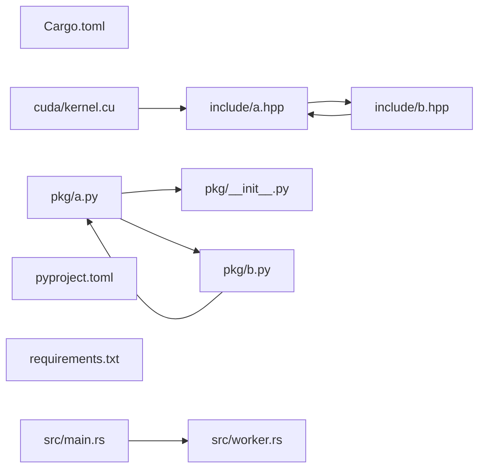

# Synthetic example

This diagram comes from the committed synthetic fixture. Only resolved file layout
candidates and literal includes appear; unresolved declarations stay in JSON.

| Dependency witness | Interpretation boundary |
| --- | --- |
| `src/main.rs:1` → `src/worker.rs` | Out-of-line Rust module layout candidate. |
| `pkg/a.py:2` → `pkg/b.py` | Relative Python module layout candidate. |
| `include/a.hpp:1` → `include/b.hpp` | Literal quoted include path. |

Strongly connected file groups: `include/a.hpp ↔ include/b.hpp`, `pkg/a.py ↔ pkg/b.py`.
